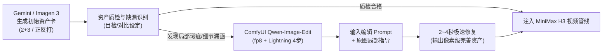

# 资产局部修补与补画工作流指南 (Qwen-Image-Edit 联动规范)

本指南规范**“Gemini 全局资产首生 + 本地 ComfyUI (Qwen-Image-Edit-2511 fp8 + 4-step Lightning) 局部微创修补”**的双引擎协同管线。

---

## 1. 为什么采用双引擎协同？

| 引擎 | 定位 | 核心优势 | 局限性 | 在管线中的职责 |
| :--- | :--- | :--- | :--- | :--- |
| **Gemini / Imagen 3** | 宏观概念与全画幅资产设计 | 语义理解强、擅长 2+3 五视图、正反打双联等复杂空间排版 | 无法做像素级自然语言微创原图修改 | **0 到 1 资产立项**：生成初始角色五视图、场景正反打大图与道具总图。 |
| **ComfyUI Qwen-Image-Edit-2511 (fp8 + Lightning 4-step)** | 本地极速微创修补 (Surgical Inpainting) | 原图保持度极高、指令遵循准、4 步采样仅需 2~3 秒、显存占用低 (fp8) | 极复杂的纯白无缝多宫格初生容易被压缩 | **1 到 1.1 精修补漏**：修补手指、增补机械义体发光、补全刀柄铆钉、消除背景瑕疵。 |

---

## 2. 闭环 SOP 操作流程

### 步骤 1：首生资产图质检
检查初始生成的角色卡或道具卡是否缺少特定微观特征（例如：萨儿右眼战术目镜细节略平淡、考希欧胸甲黄色警示条纹断续、刀柄缺少防滑铆钉）。

### 步骤 2：加载 ComfyUI Qwen-Image-Edit 蓝图
使用内置蓝图 `Image Edit (Qwen 2511)`：
- **Unet/DiT**: `qwen_image_edit_2511_fp8.safetensors`
- **Text Encoder**: `qwen_2.5_vl_7b_fp8_scaled.safetensors`
- **LoRA**: `qwen_image_edit_lightning_4step.safetensors` (权重 1.0)
- **Sampler / Scheduler**: Euler / Simple, 4 Steps, Denoise 0.8~1.0

### 步骤 3：轻量指令式修补 (Instruction-based Editing)
无需繁琐的手绘精确 Mask，直接下达自然语言增补指令：
- 例 1（补画机械目镜）：`"Add a weathered brass single-eye tactical eyepiece with glowing amber lens over the character's right eye, keeping the rest of the face unchanged."`
- 例 2（补画警示条纹）：`"Add diagonal yellow and black industrial hazard warning stripes across the chest armor plate."`
- 例 3（道具磨损精修）：`"Add fine precision grinding scratches and two brass hexagonal rivets onto the black knife handle."`

### 步骤 4：落盘并替换基准资产卡
修复后的资产图直接覆盖 `成片/character_sheets/` 对应文件，并在 `progress.json` / `plan.json` 登记，作为后续全片镜头渲染的最终权威基准。
